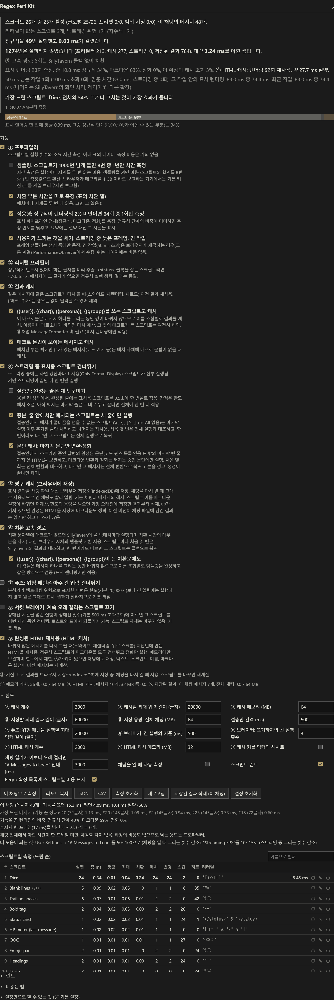
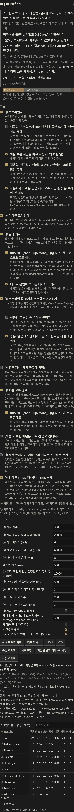

# Regex Perf Kit (SillyTavern extension)

[한국어](README.md)

Speeds up SillyTavern's built-in Regex extension **without changing a single character of your regex scripts**.

<p align="center">
  
</p>
<p align="center">
  
</p>

## When it makes a difference

Rendering one message costs, in order, **the regex scripts → the markdown conversion (showdown) → HTML sanitizing (DOMPurify)**. In a setup with few scripts and short messages the regex part is a few percent of that. So the extension does two things at once.

- **Shrinking the regex stage** (②③④⑥): felt when scripts × messages × streaming frames reaches the thousands.
- **Skipping what lies beyond regex as well** (⑨ HTML cache): when an unchanged message is rendered again (swipes, re-renders, scrolling back; reopening the chat, with ⑤), regex and markdown are both skipped. Re-renders get faster even with ten scripts.

The panel tells you whether it helps in your own setup.

- The **pipeline bar** at the top: where a render's time goes in this chat (regex / markdown / sanitize / this extension's cache lookups).
- **Measure on this chat**: the difference between the features off and on in ms, and a verdict on **whether it can be felt**. If the whole chat saves less than one frame, it says so.
- When regex is under 2% of the renders, the profiler times 1 run in 64 and the summary recommends two SillyTavern settings ("# Messages to Load", "Streaming FPS") instead of promising savings.
- It costs nothing to leave installed: CI gates on "the warm re-render is not more than 2% slower than no extension".

One note on reading the numbers: the browser's `performance.now()` usually has 0.1 ms resolution (unless the page is cross-origin isolated), so the stage split of a single message is noise. The panel shows accumulated values over dozens of renders; their totals and shares are reliable.

### Benchmark

Numbers from the test harness (SillyTavern's real regex engine, a converter stand-in with showdown-like per-call cost, a 240-message chat, 25 scripts). A synthetic benchmark: take the direction, not the digits. The measure button gives the real ones once installed.

| Scenario | No extension | This extension |
|---|---|---|
| First render of the chat (cold) | 54.7 ms | 48.9 ms |
| Re-render of the same chat (warm) | 51.1 ms | **34.2 ms** (−33%) |
| Save path, 1500 distinct inputs | 0.8 ms | 1.6 ms (+0.5 µs per input) |

## Features

| Feature | Default | What it does |
|---|---|---|
| ① Measure run time (profiler) | ON | Per script: runs, total / max ms, the part spent in the replacement (macros), and how often a run actually changed the text. Finds the slowest scripts and the ones that do nothing. Also times the whole display pipeline (regex / markdown / sanitize / cache lookups) and shows it as a bar. |
| Sampling (an option of ①) | per device | Past 1000 runs of a script, 1 run in 8 is timed and the totals are scaled. On by default on devices reporting 4 GB or less (only Chromium-based browsers report it). |
| Time the replacer separately (an option of ①) | ON | The Replacer column. Two more clock reads per match. |
| Adaptive (an option of ①) | ON | Once regex is under 2% of the renders, 1 run in 64 is timed and the summary says so. |
| What a user feels (an option of ①) | ON | Frames late while streaming and freezes over 100 ms, tasks over 50 ms (Chromium), how long opening the chat rendered. The frame sampler runs only during a generation, so idle pages pay nothing. |
| ② Skip runs that cannot match (literal prefilter) | ON | If the message does not even contain the fixed text a script looks for (e.g. both `<status>` and `</status>`, `abc` inside `(?:abc)`, either of `foo\|bar`), or is shorter than the pattern's least possible match, the regex is not run. Results are 100% identical; with the `i` flag the check folds case exactly like the regex engine. |
| ③ Reuse results (memory cache) | ON | When the same script runs on the same message again (swipes, re-renders, reloads), the previous result is reused. Scripts and text with `{{macros}}` are left out. An unchanged output is stored as a marker, not a copy. Limits: 3000 entries, 64 MB (16 / 32 MB on devices reporting 2 / 4 GB); the oldest entries go first. |
| Name macros (an option of ③) | ON | Scripts whose only macros are `{{user}}`, `{{char}}`, `{{persona}}` or `{{group}}` are cached too, per value set, since the values hold while a message is rendered. Needs the MessageFormatter hooks, like ⑤. |
| Macro syntax (an option of ③) | ON | Messages whose macro syntax lies outside the matched text (a code sample, for instance) are cached too. |
| ④ Rest display scripts while streaming | ON | While a reply is being generated, "Only Format Display" scripts are skipped and applied once when it finishes. |
| Compromise (an option of ④) | OFF | Instead of skipping them, display scripts still format the lines that are already complete, at most once per interval (default 500 ms); the line being written stays raw, and the finished reply gets every script. Needs the MessageFormatter hooks, like ⑤. |
| Incremental (an option of the compromise) | ON | **A script whose matches cannot cross a line break** (no `\n`, `\s`, `[^…]`, dotAll or `^$` without `m`; `g` required) runs only on the lines added since its last run and reuses the rest of its output, so late in a long reply the cost per tick no longer grows with the message. The first three incremental runs are checked against a full run; a difference sends that script back to full runs, with a console warning. Block patterns such as `[\s\S]*?` keep running on the whole prefix. |
| Paragraph cache (an option of the compromise) | ON | While a reply streams, the HTML of its finished paragraphs (up to the last blank line outside code fences, lists, quotes and tables) is kept, so showdown and DOMPurify run on the paragraph being written. A message's first three split renders are compared with whole ones; a difference sends it back to whole renders, with a console warning. Dropped when the generation ends; the final render is a whole one. |
| ⑤ Save results in the chat file (persistent cache) | OFF | Stores the display result in the message's `extra` so reopening the chat skips the work. With ⑨ on, the finished HTML is stored, so markdown is skipped too. Beyond a per-chat cap (8 MB by default) the oldest messages' results are dropped first. Needs a SillyTavern with the MessageFormatter hooks. |
| ⑥ Replace without SillyTavern's callback (fast path) | ON | When a script's replacement has no macros, the browser's own string-template replace does the job instead of SillyTavern's per-match callback (the Replacer column). A script's first matching runs are checked, match by match, against the callback; any difference turns ⑥ off for that script, with a console warning. |
| Name macros (an option of ⑥) | ON | Replacements and trim strings whose only macros are `{{user}}`, `{{char}}`, `{{persona}}` or `{{group}}` take the same path: the template is finished per name set (display renders only) and verified the same way. |
| ⑦ Fuse: skip very long inputs for risky patterns | OFF | A pattern the static analyzer flags for catastrophic backtracking is not run on inputs longer than the limit under Limits (20,000 characters); that text is shown as it is. Off by default, as it changes the result. |
| ⑧ Circuit breaker | OFF | After the set number of runs over the set time (3 runs over 500 ms), the script is skipped for the rest of the session, with Undo and Open script in the toast and an `off` badge (click to undo) in the table. The script itself is never changed. Off by default. |
| ⑨ HTML cache | ON | When an unchanged message is rendered again, the HTML made last time (right after the markdown conversion, before sanitizing) is reused: regex scripts and markdown are both skipped, only the sanitizer runs. A message where the text, the display scripts, the name/persona/group values, the depth rules or a markdown-related setting changed is formatted again. A message matched by a script whose value can differ between renders (`{{random}}`, `{{getvar}}`, ...) is not stored. Memory only (2000 entries / 32 MB; 8 MB on devices reporting 2 GB, 16 MB at 4 GB), stored in the chat too when ⑤ is on. Needs the MessageFormatter hooks, like ⑤. The key and the hit path are under [How it works](#how-it-works). |

## Install

1. Put this folder (`st-regex-perf`) in one of:
   - `SillyTavern/data/<user>/extensions/st-regex-perf/` (recommended)
   - or `SillyTavern/public/scripts/extensions/third-party/st-regex-perf/`
2. Reload SillyTavern in the browser.
3. A **Regex Perf Kit** drawer appears at the bottom of the Extensions panel (🧩).

Requires SillyTavern 1.15.0 or later (a regex engine with `RegexProvider`). The UI is in Korean when SillyTavern's language is Korean, and in English otherwise; translations are one `locales/<locale>.json` file each, so another language is just another file.

## Use

### Summary and bar

- Reopen the chat or render a few messages to fill the table. The summary counts scripts as active/total per origin (global / preset / scoped).
- The summary is a few sentences.
  - How many regex runs really happened and how long they took; how many ②, ③, ④ (and ⑤) avoided.
  - The **time saved**: skipped runs × each script's average run time. It can exceed the time spent (that is work that never ran). Until a run has been measured, no saving is shown.
  - **The shares of a display render's stages** (regex / markdown / sanitize / cache lookups) with ⑨'s reuse count and saving; the bar under the summary draws the same shares.
  - **What a user feels**: frames late while streaming and freezes over 100 ms, tasks over 50 ms and how many of them while streaming, how long opening the chat rendered.
  - When regex is under 2%, it says that ②③④ have little to save here.
- Each feature is described under its checkbox, and the table's columns and badges under **How to read the table**.

### Measuring

- **Measure on this chat** re-renders the current chat once with the features off and once on, and shows the time actually saved. It runs in small steps (10 messages at a time), so the page stays usable; the measurement does not show up in the stats.
- Under the result (and in the text report) it lists the 5 slowest messages with the features off (index, length, ms) and gives a **verdict**:
  - the stage shares of the render with the features off;
  - how the number of messages taking more than a frame (16.7 ms) on their own changed;
  - when the whole chat saves less than one frame, that nothing can be felt, with the two SillyTavern settings that help more.
- Since ⑨ makes most of the "on" render cache hits, this measures how much faster a re-render (swipe, reload) gets.
- When opening a chat took longer than the threshold under **Limits** (3 s by default), a toast suggests a lower "# Messages to Load", once per session. "Measure automatically when a chat opens" (off by default) runs the measurement above once each time a chat opens.

### The table

- Ordered by total time by default; click a column header to sort by that column, again to flip the direction (the # column keeps the rank by total time). The box above the table shows only scripts whose name contains what you type. Neither is saved.
- Scripts taking **50% or more of the total time** are highlighted: turning off or fixing those helps most.
- **Replacer** is the part of the total spent in SillyTavern's replacer (group filling, trim strings, macros). If it is large, the replacement is slow, not the pattern.
- **Matched** counts the runs where the pattern matched (even if the text came out the same); **Changed** those that actually changed the text.
- Scripts whose **Literal** column says "none" get no benefit from ② and always run (unless the minimum length alone rules a message out). `"a" & "b"` means both must be present, `"a" | "b"` any one of them; hover a cell for the shortest possible match and, when there is no literal, the reason (only classes, every literal optional, a branch without one, ...).
- The table lists only patterns that ran or were skipped at least once. In a narrow panel (phones) no column is hidden: the table scrolls sideways, and the Script column sticks to the left.
- Click a row to open the script in SillyTavern's regex editor. The power button at the end of the row turns the script off (saved through the regex engine, so the Regex drawer may stay closed). The stopwatch button re-renders this chat without that one script and shows the time it costs (ms) inline in the row (measured with ③ and ⑤ off; it does not show up in the stats). Patterns that are not scripts have none of these.

### Badges next to a name

- `(a+)+` exponential backtracking: a nested quantifier or an alternation whose branches can start with the same character, as the static analyzer reads the pattern's shape. Hover for the reason and a rewrite; the text report has a "Backtracking risks" section.
- `a*a*` polynomial backtracking: adjacent quantifiers that can match the same characters.
- `fuse` inputs ⑦ skipped. `off` a script ⑧ turned off for the session (click to turn it back on).
- `⚡` a single run took over 50 ms. The 20 newest spikes are kept with the message they happened on: hover the badge for the newest spike's input length and first 80 characters, click it to scroll to that message, and use the copy icon in the row to put a repro (pattern, input length and head) on the clipboard. Also listed in the text report's "Spikes" section.
- `⇅` order conflict: an earlier script removed what this one looks for, so a match was lost. The summary and the report name the pair and the count; on inputs up to 4000 characters the match is verified by running the pattern.
- `∅` ran 20+ times without ever matching (a candidate to disable, also listed in the summary). A script that matches but leaves the text as it is gets no mark.

### Lint and invalid patterns

- **Lint** (a section under the table) finds: missing `g` (the pattern matched again further on in a message, 3 times), group references the pattern cannot fill (`$3` with two groups, `$<name>` without a named group), JSON double escapes such as `\\n`, browser support (on Safari and iOS: lookbehind before 16.4, the `v` flag and duplicate group names before 17, the `d` flag before 15), duplicate patterns.
- Where a fix is mechanical (Add g, Unescape) the button shows the change and saves it through the regex engine once you confirm. Nothing is changed on its own.
- **Invalid patterns** (a script whose pattern does not compile does nothing, silently, in SillyTavern) are listed with the engine's error in the summary and the report.

### Reports and commands

- `/regexperf` shows the report in a popup. `/regexperf text` returns it as text. `/regexperf json` and `/regexperf csv` return data (JSON: the whole report, CSV: the table). The panel's JSON and CSV buttons copy the same to the clipboard.
- `/regexperf reset` resets the stats. `/regexperf measure` runs "Measure on this chat". `/regexperf off <script name>` turns a script off (exact name, else the only one containing it).
- With **Show each script's cost in the Regex extension's list** (Limits, on by default) a chip after each script name in SillyTavern's own Regex drawer shows its total ms, share of all regex time and the marks of the table, so cost is visible while you reorder and toggle scripts.

### Limits and settings

- **Limits** lets you change ③'s entry count, longest cached input and memory (MB), ⑤'s longest saved result and per-chat size (MB), the compromise interval, ⑦'s longest input, ⑧'s threshold and count, and ⑨'s entry count and memory (MB). The lint and the Regex list's cost chips are turned off here too.
- "③ Key the cache by a hash of the input" (off by default) keeps a 64-bit hash instead of each input, about halving the memory; the cost is hashing every input, and two inputs of the same length and hash (once in billions with 64 bits) would share a result.
- The line above Limits shows ③'s and ⑨'s usage and this chat's ⑤ storage against its cap.
- **Reset settings** turns every feature and limit back to its default. Whether the Limits, legend and tips sections are open is remembered.

## SillyTavern settings that help

- **User Settings → "# Messages to Load"**: how many messages are rendered when a chat opens. 0 = all. 50–100 makes loading much faster.
- **User Settings → "Streaming FPS"**: screen updates per second while streaming. Every update runs all display regexes, so 10–15 reduces lag.

These two often do more than anything this extension does. When the measurement's verdict is "nothing can be felt", or regex is a few percent of the render, keep the extension for its profiler, lint and ⑨, and adjust these first.

## How it works

SillyTavern's regex engine compiles every pattern through `RegexProvider.instance.get()`. This extension wraps that method to
return a RegExp subclass with an instrumented `[Symbol.replace]`. `String.prototype.replace()` dispatches through that symbol, so
every script run passes through one place. The matching itself runs on a plain RegExp, keeping V8's fast path.
No SillyTavern core file is modified.

- Script info (replacement, display-only flag, ...) is re-read whenever it changes, so editing a script or switching presets takes
  effect without reloading the chat. When several scripts share a pattern, caching and the streaming skip apply only if they suit all of them.
- ②'s literal check runs once per input string: however many scripts look for the same literal, and however often a displayed message is re-rendered (the 256 most recent are remembered, or twice the chat's messages when that is more), each literal is scanned once.
- Streaming is only checked while a generation runs (`GENERATION_STARTED` until `GENERATION_ENDED`/`GENERATION_STOPPED`), so
  display scripts pay nothing for the check otherwise.
- Pipeline timing: SillyTavern's `messageFormatting()` runs, per message, BEFORE_REGEX hooks → regex scripts → AFTER_REGEX hooks → markdown fix-ups, quotes, showdown → AFTER_MARKDOWN hooks → name strip → DOMPurify. This extension's hooks sit at the stage boundaries (last of BEFORE_REGEX, first of AFTER_REGEX and AFTER_MARKDOWN), and `DOMPurify.sanitize()` is wrapped to recognize the `MESSAGE_SANITIZE` config only `messageFormatting()` uses. So one display render is timed in four parts (cache lookups / regex / markdown / sanitize). The output is untouched.
- ⑨'s key: a 64-bit hash of the text + the display scripts' version + the name, persona and group values + the depth rules + the markdown-related settings (auto-fix, encode tags, reasoning prefix/suffix, escape strings). A message where a script whose find pattern holds a macro such as `{{random}}` applied is not stored either.
- A ⑨ hit returns a short placeholder at BEFORE_REGEX. The regex scripts are bypassed (as ③④ do), the markdown fix-ups run on three characters, a wrapper around `showdown.Converter.prototype.makeHtml` passes that placeholder through unconverted, and AFTER_MARKDOWN swaps in the stored HTML. showdown's cost is largely per call rather than per character, so without this wrapper a hit would still pay most of the markdown stage. The name strip and DOMPurify after it run as always.
- Sanitizing is not skipped on purpose: its output depends on state as well as settings (external media allowances, for one), so a stale result could change what it means for safety.
- Incremental streaming (an option of ④'s compromise mode) applies only to scripts the pattern analyzer judges line-local, and a script's first three incremental runs are compared with a full run: the same self-verification principle as the fast path (⑥).
- The paragraph cache (an option of ④'s compromise mode) works inside the `makeHtml` wrapper: the text is split at its last paragraph boundary (a blank line after a plain paragraph, a heading or a closed code fence, outside fences, lists, quotes, tables and open HTML tags, with an even number of backticks before it), and the kept HTML of the finished part is joined to the converted tail by one line break.
- showdown joins blocks with one line break, so that equals a whole conversion (checked on 20 samples with SillyTavern's converter options). A message holding a reference-style link definition (`[id]: url`) is never split.
- The marker between the two HTML parts is taken out by this extension's own AFTER_MARKDOWN hook (the first to run), which remembers where it was; the `DOMPurify.sanitize` wrapper splits there and sanitizes the tail only, reusing the finished part's sanitized HTML. If another hook changed the finished part, the whole HTML is sanitized. The first three split renders are compared with whole ones.

## Caveats

- This extension runs arbitrary JS. All of it is in `index.js`; read it before installing. Nothing is sent anywhere.
- ⑤ can make chat files larger. "Clear saved results (this chat)" removes its entries.
- ⑤ and ⑨ do not store a message that a script using `{{random}}`, `{{time}}`, `{{getvar}}` and the like **matched** (its value may differ per render, so it is computed every time). Script changes, name, persona and group changes, message depth (min/max depth) and the markdown-related User Settings are picked up automatically.
- The HTML ⑨ stores includes what **other extensions' AFTER_REGEX hooks** did to that message (hooks after AFTER_MARKDOWN run again on a hit). After turning such an extension on or off, toggle ⑨ off and on once (which clears the memory cache) or press "Clear saved results".
- ⑨ wraps `showdown.Converter.prototype.makeHtml`. The wrapper only acts while this extension is serving a hit and exactly its placeholder comes in; every other call (other extensions' converters included) passes through.
- Long tasks among the felt figures are counted only where `PerformanceObserver` offers them (Chromium-based browsers). The frame sampler works everywhere.
- If a SillyTavern version has no `RegexProvider`, patching fails and the panel shows a warning (everything stays off, no side effects). If another extension had already replaced `RegexProvider.instance.get()`, or replaces it later, the panel and the console warn once.

## Development

```
npm install
npm test
```

- `npm test` lints with SillyTavern's ESLint rules, fuzzes the literal extractor (`extractNeedle`; it fails if the regex matches text the prefilter skipped), and compares no extension / the baseline commit (`BASELINE` in `tests/server.mjs`) / the working tree in headless Chrome on SillyTavern's real regex engine (`RegexProvider`/`runRegexScript`) and its whole `messageFormatting()`. Only the markdown converter and DOMPurify are stand-ins: the converter is the identity by default, or, with `setConverter('para')`, one with showdown-like per-call cost.
- The harness server sends cross-origin isolation headers so `performance.now()` has 5 µs resolution (otherwise 0.1 ms, which makes stage times noise).
- SillyTavern's files are downloaded at test time from the commits pinned in `tests/st-version.json` (one release, one staging; they are AGPL, so they are not part of this repository). `ST_REF=release npm test` picks the other one (default staging); set `CHROME_PATH` to choose the Chrome binary. The tests pin Chrome to en-US and `navigator.deviceMemory` to 8.
- `node tests/run-one.mjs <scenario>` runs one scenario on the working tree and prints its result. `BASELINE_COMMIT=<sha> npm run bench` makes the bench's "baseline" variant that commit, interleaved with the working tree.
- `npm run screenshots` regenerates the README's panel screenshots (`docs/`) from the harness.
- GitHub Actions runs the same tests against both commits on every push and pull request, and `npm run bench -- --gate` fails when the warm re-render of a long chat, relative to no extension, is more than 5% slower than the ratio stored in `tests/bench-baseline.json`, or **more than 2% slower than no extension at all** (re-measured up to twice, as runners are noisy). `npm run bench -- --update` refreshes the baseline; plain `npm run bench` only prints the comparison.
