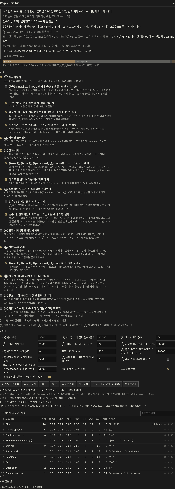
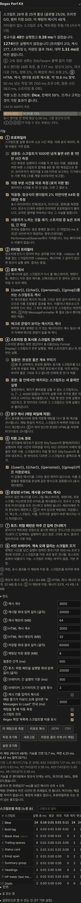

# Regex Perf Kit (SillyTavern 확장)

[English](README.en.md)

정규식 스크립트를 **한 글자도 건드리지 않고** 정규식 확장의 체감 속도를 올리는 확장입니다.

## 먼저: 이 확장이 효과를 내는 조건

메시지 하나를 화면에 그리는 비용은 **정규식 스크립트 → 마크다운 변환(showdown) → HTML 정화(DOMPurify)** 순으로 쌓이고, 스크립트가 적고 메시지가 짧은 환경에서는 정규식이 그중 몇 %에 불과합니다. 그래서 이 확장은 두 가지를 함께 합니다.

- **정규식 단계를 줄이는 것**(②③④⑥): 스크립트 수 × 메시지 수 × 스트리밍 프레임 수가 수천 단위로 올라갈 때 티가 납니다.
- **정규식 바깥을 함께 건너뛰는 것**(⑨ HTML 캐시): 바뀌지 않은 메시지를 다시 그릴 때(스와이프, 재렌더링, 위로 스크롤, ⑤와 함께면 채팅 다시 열기) 정규식과 마크다운을 모두 건너뜁니다. 스크립트가 10개뿐이어도 재렌더링은 빨라집니다.

패널 맨 위의 **파이프라인 막대**가 지금 채팅에서 시간이 어디에 쓰이는지(정규식 / 마크다운 / 정화 / 이 확장의 캐시 조회)를 보여주고, **이 채팅으로 측정** 버튼은 기능을 끈 상태와 켠 상태의 차이를 ms와 함께 **"체감할 수 있는 차이인지"**로 판정합니다(채팅 전체에서 한 프레임도 못 아끼면 그렇게 말합니다). 정규식이 렌더링의 2% 미만이면 프로파일러가 스스로 물러나고(64회 중 1회 측정), 요약은 절약 대신 ST 설정 두 개("# Messages to Load", "Streaming FPS")를 권합니다. 설치해 두어도 손해는 없도록, CI가 "확장 없음 대비 재렌더링이 2% 넘게 느려지지 않음"을 게이트로 겁니다.

측정값 해석에 한 가지 주의: 브라우저의 `performance.now()`는 보통 0.1 ms 단위라(교차 출처 격리된 페이지가 아닌 한), 메시지 하나의 단계 분해는 노이즈입니다. 패널은 수십 회 이상 누적한 값만 보여주고, 그 합계와 비율은 믿을 만합니다.

테스트 하네스(ST의 실제 정규식 엔진 + 실제 showdown 비용에 맞춘 변환기 스탠드인, 240개 메시지 채팅, 25개 스크립트)의 수치입니다. 합성 벤치이니 방향만 보세요. 실제 수치는 설치 후 측정 버튼이 알려줍니다.

| 시나리오 | 확장 없음 | 이 확장 |
|---|---|---|
| 채팅 첫 렌더링 (cold) | 54.7 ms | 48.9 ms |
| 같은 채팅 재렌더링 (warm) | 51.1 ms | **34.2 ms** (−33%) |
| 저장 경로, 1500개의 서로 다른 입력 | 0.8 ms | 1.6 ms (입력당 +0.5 µs) |

<p align="center">
  
</p>
<p align="center">
  
</p>

| 기능 | 기본값 | 설명 |
|---|---|---|
| ① 프로파일러 | ON | 스크립트마다 몇 번 실행되고 얼마나 걸렸는지(총/최대 ms, 그중 치환문·매크로에 쓴 시간, 텍스트를 실제로 바꾼 횟수)를 재서 표로 보여줍니다. 가장 느린 스크립트와 효과 없는 스크립트를 찾아줍니다. 표시 파이프라인 전체(정규식 / 마크다운 / 정화 / 이 확장의 캐시 조회)도 재서 막대로 보여줍니다. 하위 옵션 넷: 샘플링(한 스크립트가 1000번 넘게 돌면 8번 중 1번만 재고 합계를 환산. 브라우저가 메모리를 4 GB 이하로 보고하는 기기(크롬 계열 브라우저만 보고)에서 기본 켜짐), 치환 시간 따로 재기, **적응형**(정규식이 렌더링의 2% 미만이면 64회 중 1회만 측정하고 요약이 그 사실을 말함, 기본 켜짐), **체감 지표**(스트리밍 중 늦은 프레임·100 ms 넘는 멈춤, 50 ms 넘는 긴 작업(크로미움), 채팅을 열 때의 렌더링 시간; 프레임 샘플러는 생성 중에만 돌아 쉬는 페이지에는 비용이 없음, 기본 켜짐). |
| ② 리터럴 프리필터 | ON | 스크립트가 찾는 고정 문구(예: `<status>`와 `</status>` 둘 다, 그룹 안의 `(?:abc)`, `foo\|bar`면 둘 중 하나)가 메시지에 아예 없거나, 메시지가 패턴의 최소 매치 길이보다 짧으면 정규식을 돌리지 않습니다. 결과는 100% 동일합니다. `i` 플래그는 정규식 엔진과 똑같은 대소문자 규칙으로 확인합니다. |
| ③ 결과 캐시 | ON | 같은 메시지에 같은 스크립트를 다시 적용할 때(스와이프·다시 그리기·재로드) 이전 결과를 그대로 씁니다. `{{매크로}}`가 든 스크립트나 텍스트는 제외하되, 하위 옵션 둘(기본 켜짐)로 `{{user}}`·`{{char}}`·`{{persona}}`·`{{group}}`만 쓰는 스크립트(메시지를 그리는 동안 값이 같으므로 값 조합별로 캐시. ⑤처럼 MessageFormatter 훅 필요)와 매치된 부분 밖에만 매크로 문법이 있는 메시지는 캐시합니다. 바뀌지 않은 결과는 복사본 대신 표시만 저장합니다. 개수(3000개)와 메모리(64 MB, 브라우저가 메모리를 2 GB 이하로 보고하면 16 MB, 4 GB 이하면 32 MB) 한도를 넘으면 오래된 것부터 지웁니다. |
| ④ 스트리밍 중 표시용 스크립트 건너뛰기 | ON | 답변이 생성되는 동안 "Only Format Display" 스크립트를 건너뛰고, 생성이 끝나면 한 번만 적용합니다. |
| 절충안 (④의 옵션) | OFF | ④가 켜져 있을 때, 건너뛰는 대신 이미 완성된 줄에는 표시용 스크립트를 일정 간격(기본 500 ms)마다 적용합니다. 써지는 중인 줄은 그대로 보이고, 생성이 끝나면 전부 적용됩니다. ⑤처럼 MessageFormatter 훅 필요. |
| 증분 (절충안의 옵션) | ON | 절충안에서, **매치가 줄바꿈을 넘을 수 없는 스크립트**(`\n`·`\s`·`[^…]`·dotAll·`m` 없는 `^$` 가 없는 패턴, `g` 필수)는 마지막 실행 이후 추가된 줄에만 돌고 앞부분 출력은 재사용합니다. 긴 답변 후반부에서 틱당 비용이 메시지 길이에 비례하지 않게 됩니다. 스크립트마다 처음 3번은 전체 실행과 대조하고, 다르면 그 스크립트는 전체 실행으로 돌아가며 콘솔에 경고를 남깁니다. `[\s\S]*?` 같은 블록 패턴은 그대로 전체에 돕니다. |
| ⑤ 영구 캐시 | OFF | 표시 결과를 메시지(`extra`)에 저장해 채팅을 다시 열 때 계산을 건너뜁니다. ⑨가 켜져 있으면 완성된 HTML을 저장해 마크다운도 건너뜁니다. 채팅당 용량 한도(기본 8 MB)를 넘으면 오래된 메시지의 결과부터 지웁니다. MessageFormatter 훅이 있는 ST 필요. |
| ⑥ 치환 고속 경로 | ON | 치환 문자열에 매크로가 없으면 SillyTavern의 콜백(매치마다 호출, 표의 치환 열) 대신 브라우저 정규식 엔진의 문자열 템플릿 치환을 씁니다. 하위 옵션(기본 켜짐)으로 `{{user}}`·`{{char}}`·`{{persona}}`·`{{group}}`만 쓰는 치환문·트림 문자열도 이름 조합별로 템플릿을 완성해 같은 경로를 탑니다(표시 렌더링만). 스크립트(와 이름 조합)마다 처음 몇 번의 매치는 콜백 결과와 하나하나 대조하고, 한 번이라도 다르면 그 스크립트는 콜백으로 되돌리며 콘솔에 경고를 남깁니다. |
| ⑦ 퓨즈 | OFF | 정적 분석기가 백트래킹 위험으로 표시한 패턴은 한도(20,000자)보다 긴 입력에는 실행하지 않고 원문 그대로 보여줍니다. 결과가 달라지므로 기본 꺼짐. |
| ⑧ 서킷 브레이커 | OFF | 정해진 시간을 넘긴 실행이 정해진 횟수(500 ms 초과 3회)에 이르면 그 스크립트를 이번 세션 동안 건너뜁니다. 토스트의 되돌리기·스크립트 열기와 표의 `off` 배지(누르면 되돌리기)로 해제할 수 있고, 스크립트 자체는 바꾸지 않습니다. 기본 꺼짐. |
| ⑨ HTML 캐시 | ON | 바뀌지 않은 메시지를 다시 그릴 때 지난번에 만든 HTML(마크다운 변환 직후, 정화 직전)을 재사용합니다. 정규식 스크립트와 마크다운 변환을 모두 건너뛰고 정화만 돕니다. 키는 메시지 텍스트의 64비트 해시 + 표시 스크립트 버전 + 이름·페르소나·그룹 값 + 깊이 규칙 + 마크다운 관련 설정(auto-fix, encode tags, 추론 접두/접미, 이스케이프 문자열): 그중 하나라도 바뀐 메시지는 다시 처리합니다. `{{random}}`·`{{getvar}}`처럼 렌더링마다 값이 달라질 수 있는 스크립트가 매치한 메시지(그리고 찾기 패턴에 그런 매크로가 든 스크립트가 적용된 메시지)는 저장하지 않습니다. 메모리에만 두며(2000개 / 32 MB, 2 GB 이하 기기 8 MB, 4 GB 이하 16 MB), ⑤가 켜져 있으면 채팅에도 저장합니다. ⑤처럼 MessageFormatter 훅(AFTER_MARKDOWN 단계) 필요. |

## 설치

1. 이 폴더(`st-regex-perf`)를 아래 중 한 곳에 넣습니다.
   - `SillyTavern/data/<유저명>/extensions/st-regex-perf/`  (권장)
   - 또는 `SillyTavern/public/scripts/extensions/third-party/st-regex-perf/`
2. 브라우저에서 ST를 새로고침합니다.
3. Extensions 패널(🧩) 아래쪽에 **Regex Perf Kit** 드로어가 생깁니다.

ST 1.15.0 이상(정규식 엔진에 `RegexProvider`가 있는 버전)이 필요합니다. 화면은 ST 언어가 한국어면 한국어, 그 밖에는 영어로 나옵니다. 번역은 `locales/<locale>.json` 파일 하나씩이라 다른 언어도 파일만 추가하면 됩니다.

## 사용

- 채팅을 한 번 다시 열거나 메시지 몇 개를 렌더링하면 표가 채워집니다. 요약의 스크립트 수는 글로벌 / 프리셋 / 범위 지정별로 활성/전체를 보여줍니다. 각 기능의 설명은 패널의 체크박스 아래에, 표의 열·배지 설명은 표 아래 **표 읽는 법**에 있습니다.
- 요약은 몇 문장입니다: 실제로 돌아간 정규식 횟수와 그 시간, ②·③·④(와 ⑤)가 피한 횟수, 그리고 **아낀 시간**(건너뛴 횟수 × 스크립트별 평균 실행 시간이라서 실제 실행 시간보다 클 수 있습니다. 그만큼 안 돌린 것). 측정된 실행이 아직 없으면 아낀 시간은 표시하지 않습니다. 그 아래에 **표시 렌더링의 단계별 비중**(정규식 / 마크다운 / 정화 / 캐시 조회)과 ⑨가 재사용한 횟수·아낀 시간, **체감 지표**(스트리밍 중 늦은 프레임 수와 100 ms 넘는 멈춤, 50 ms 넘는 긴 작업 수와 그중 스트리밍 중인 것, 채팅을 열 때 렌더링에 걸린 시간)가 이어지고, 요약 밑의 막대가 같은 비중을 그림으로 보여줍니다. 정규식이 2% 미만이면 "여기서는 ②③④가 아낄 것이 거의 없다"고 말합니다.
- `/regexperf` 로 팝업 리포트, `/regexperf text` 로 텍스트 리포트, `/regexperf json` · `/regexperf csv` 로 데이터(JSON은 리포트 전체, CSV는 표), `/regexperf reset` 으로 측정 초기화, `/regexperf measure` 로 "이 채팅으로 측정", `/regexperf off <스크립트 이름>` 으로 스크립트 끄기(이름이 정확히 같은 것, 없으면 그 글자가 든 유일한 것). 패널의 JSON · CSV 버튼은 같은 내용을 클립보드에 복사합니다.
- 채팅을 열었을 때 그리는 데 **한도**의 기준(기본 3초)보다 오래 걸리면, 세션당 한 번 "# Messages to Load"를 낮추라는 토스트가 뜹니다. 한도의 "채팅을 열 때 자동 측정"(기본 꺼짐)을 켜면 채팅을 열 때마다 아래 측정을 한 번 자동으로 합니다.
- **이 채팅으로 측정** 버튼은 지금 채팅을 기능을 끈 상태와 켠 상태로 한 번씩 다시 렌더링해 실제로 줄어든 시간을 보여줍니다. 메시지 10개씩 나누어 돌리므로 측정 중에도 화면을 계속 쓸 수 있고, 측정값(표)에는 남지 않습니다. 결과 아래(그리고 텍스트 리포트)에 기능을 끈 상태에서 가장 느렸던 메시지 5개(번호, 길이, ms)와 **판정**이 나옵니다: 기능을 끈 렌더링의 단계별 비중, 혼자서 한 프레임(16.7 ms)을 넘긴 메시지 수의 변화, 그리고 아낀 시간이 채팅 전체에서 한 프레임도 안 되면 "체감할 차이가 없다"는 말과 함께 더 도움이 되는 ST 설정 두 개. 켠 상태의 렌더링은 ⑨ 덕에 대부분 캐시 적중이므로, 이 측정은 "재렌더링(스와이프·재로드)이 얼마나 빨라지는가"를 재는 것입니다.
- 표는 기본적으로 총 ms 순입니다. 열 머리글을 누르면 그 열로 정렬되고 다시 누르면 방향이 바뀝니다(# 열은 총 ms 기준 순위 유지). 표 위의 입력란에 글자를 넣으면 이름에 그 글자가 든 스크립트만 보입니다. 정렬과 필터는 저장되지 않습니다.
- 표에서 **총 ms 비중이 50% 이상**인 스크립트는 강조 표시됩니다. 그 스크립트를 끄거나 수정하는 것이 가장 효과가 큽니다.
  - **치환** 열은 총 ms 중 ST의 치환 함수(그룹 채우기, 트림 문자열, 매크로)에 쓴 시간입니다. 이 값이 크면 패턴이 아니라 치환문이 느린 것입니다.
  - **매치** 열은 패턴이 매치된 실행 횟수(텍스트가 그대로였어도 포함), **변경** 열은 텍스트를 실제로 바꾼 횟수입니다.
- 이름 옆 배지:
  - `(a+)+` 지수적 백트래킹: 정적 분석기가 패턴 모양에서 읽어낸 중첩 수량자 또는 같은 글자로 시작할 수 있는 분기의 선택 (마우스를 올리면 이유와 고칠 방법, 텍스트 리포트에는 "백트래킹 위험" 섹션)
  - `a*a*` 다항 백트래킹: 같은 글자를 받을 수 있는 수량자가 연달아 있음
  - `fuse` ⑦이 건너뛴 입력, `off` ⑧이 이번 세션 동안 끈 스크립트 (누르면 다시 켬)
  - `⚡` 한 번 실행에 50 ms 넘게 걸린 적 있음. 배지에 마우스를 올리면 가장 최근 스파이크의 입력 길이와 앞 80글자가 보이고, 텍스트 리포트의 "스파이크" 절에도 실립니다.
  - `⇅` 순서 충돌: 앞선 스크립트가 이 스크립트가 찾는 글자를 지워서 매치가 사라짐 (요약과 리포트에 어느 스크립트 쌍인지, 몇 번인지 표시. 4000글자 이하 입력에서는 실제로 매치했을지 정규식으로 확인)
  - `∅` 20회 이상 실행했지만 한 번도 매치하지 않음 (끄기 후보, 요약에도 표시). 매치는 되지만 텍스트가 그대로인 스크립트는 표시하지 않습니다.
- **린트**(표 아래 항목): 누락된 `g`(한 메시지에서 뒤에 또 매치될 수 있었던 경우 3회), 패턴에 없는 그룹 참조(그룹이 둘인데 `$3`, 이름 그룹이 없는데 `$<name>`), `\\n` 같은 JSON 이중 이스케이프, 브라우저 지원(구형 브라우저에서 무효: Safari·iOS 기준 lookbehind는 16.4 미만, `v` 플래그와 중복 그룹 이름은 17 미만, `d` 플래그는 15 미만), 중복 패턴. 기계적으로 고칠 수 있는 항목(g 추가, 이스케이프 풀기)은 버튼이 변경 내용을 보여 주고 확인하면 정규식 엔진을 통해 저장합니다. 저절로 바꾸는 것은 없습니다.
- **무효 패턴**(컴파일되지 않는 패턴의 스크립트는 ST에서 아무 동작 없이 조용히 지나갑니다)은 요약과 리포트에 엔진의 오류 메시지와 함께 나옵니다.
- ⚡ 배지는 최근 스파이크 20개를 발생한 메시지와 함께 기억합니다. 배지를 누르면 가장 최근 메시지로 스크롤되고, 행의 복사 아이콘은 재현 정보(패턴, 입력 길이와 앞부분)를 클립보드에 넣습니다.
- **Regex 확장 목록에 스크립트별 비용 표시**(한도, 기본 켜짐)를 켜면 ST의 Regex 서랍에서 스크립트 이름 뒤에 총 ms, 전체 대비 비율, 표의 표시 기호가 칩으로 붙어 순서를 바꾸거나 끄고 켤 때 비용이 바로 보입니다.
- 표의 행을 누르면 그 스크립트가 ST 정규식 편집기에서 열리고, 행 끝의 전원 버튼은 스크립트를 끕니다(정규식 엔진을 통해 저장되므로 Regex 서랍이 닫혀 있어도 됩니다). 스크립트가 아닌 패턴은 이 두 버튼이 없습니다. 스톱워치 버튼은 이 채팅을 그 스크립트만 빼고 다시 그려 그 스크립트가 드는 시간(ms)을 행 안에 보여줍니다(③·⑤는 끈 상태로 측정, 측정값에는 남지 않음).
- **리터럴** 열이 "없음"인 스크립트는 ②의 혜택을 못 받고 매번 실행됩니다(최소 길이만으로 거르는 경우는 예외). `"a" & "b"`는 둘 다, `"a" | "b"`는 그중 하나라도 있어야 실행합니다. 셀에 마우스를 올리면 최소 매치 길이와, 리터럴이 없는 경우 그 이유(클래스만 있음, 모든 리터럴이 선택적, 선택지 중 리터럴 없는 가지 등)가 보입니다. 표는 한 번이라도 실행되거나 건너뛴 스크립트만 보여줍니다. 패널이 좁으면(모바일) 열을 숨기지 않고 표를 가로로 스크롤하며, 스크립트 열은 왼쪽에 고정되어 어느 열을 보든 이름이 보입니다.
- **설정 초기화** 버튼은 모든 기능과 한도를 기본값으로 되돌립니다. 한도 · 표 읽는 법 · 설정 팁 섹션은 펼친 상태가 기억됩니다.
- **한도**를 펼치면 ③ 캐시 개수 / 캐시할 최대 입력 길이 / 캐시 메모리(MB) / ⑨ HTML 캐시 개수와 메모리(MB) / ⑤ 저장 최대 길이 / ⑤ 채팅당 저장 용량(MB) / 절충안 간격 / ⑦ 퓨즈의 최대 입력 길이 / ⑧ 브레이커의 기준 시간과 횟수를 바꿀 수 있고, 린트와 Regex 목록의 비용 칩을 끄고 켤 수 있습니다. "③ 캐시 키를 입력의 해시로"(기본 꺼짐)를 켜면 입력 대신 64비트 해시만 보관해 메모리가 절반쯤 줍니다. 대신 입력마다 해시를 계산하고, 길이와 해시가 모두 같은 두 입력(64비트라 수십억 건에 한 번꼴)이 결과를 공유할 수 있습니다. 바로 위 줄에 ③·⑨ 캐시 사용량과 이 채팅의 ⑤ 저장량(한도 대비)이 나옵니다.

## 설정만으로 되는 것

- **User Settings → "# Messages to Load"**: 채팅을 열 때 렌더링하는 메시지 수. 0=전부. 50~100으로 줄이면 로딩이 크게 빨라집니다.
- **User Settings → "Streaming FPS"**: 스트리밍 중 화면 갱신 횟수. 갱신마다 표시용 정규식이 전부 돌아가므로 10~15로 낮추세요.

이 두 설정은 이 확장이 하는 어떤 일보다 먹히는 경우가 많습니다. 측정 버튼의 판정이 "체감할 차이가 없다"거나 정규식 비중이 몇 %에 그치면, 확장은 프로파일러·린트·⑨ 용도로 두고 이 둘을 먼저 조정하세요.

## 동작 원리

ST의 정규식 엔진은 모든 패턴을 `RegexProvider.instance.get()`으로 컴파일합니다. 이 확장은 그 메서드를 감싸서
`[Symbol.replace]`가 계측된 RegExp 서브클래스를 돌려줍니다. `String.prototype.replace()`는 이 심볼로 디스패치되므로
모든 스크립트 실행이 한 지점을 통과합니다. 실제 매칭은 서브클래스가 아닌 일반 RegExp에서 실행해 V8의 빠른 경로를 그대로 씁니다.
ST 코어 파일은 수정하지 않습니다.

- 스크립트 정보(치환문, 표시 전용 여부 등)는 바뀔 때마다 다시 읽으므로, 스크립트를 고치거나 프리셋을 바꾸면 채팅을 다시 불러오지 않아도 바로 반영됩니다. 같은 패턴을 쓰는 스크립트가 여러 개면 모두에게 맞는 경우에만 캐시와 스트리밍 스킵을 적용합니다.
- ②의 리터럴 확인은 입력 문자열마다 한 번씩만 합니다. 같은 리터럴을 찾는 스크립트가 여러 개여도, 표시용 메시지가 다시 그려져도(최근 256개, 채팅 메시지 수의 두 배가 더 크면 그만큼) 스캔은 한 번입니다.
- 스트리밍 여부는 생성이 진행 중일 때(`GENERATION_STARTED` ~ `GENERATION_ENDED`/`GENERATION_STOPPED`)만 확인하므로, 평소에는 표시용 스크립트마다 드는 확인 비용이 없습니다.
- ST의 `messageFormatting()`은 메시지마다 BEFORE_REGEX 훅 → 정규식 스크립트 → AFTER_REGEX 훅 → 마크다운 보정·인용부호·showdown → AFTER_MARKDOWN 훅 → 이름 제거 → DOMPurify 순으로 돕니다. 이 확장의 훅은 단계 경계에 앉고(BEFORE_REGEX의 마지막, AFTER_REGEX와 AFTER_MARKDOWN의 처음), `DOMPurify.sanitize()`는 `messageFormatting()`만 쓰는 `MESSAGE_SANITIZE` 설정을 알아보도록 감싸서 한 번의 표시 렌더링을 네 구간(이 확장의 캐시 조회 / 정규식 / 마크다운 / 정화)으로 잽니다. 출력은 건드리지 않습니다.
- ⑨의 적중은 BEFORE_REGEX에서 짧은 자리표시자를 돌려보내는 방식입니다: 정규식 스크립트는 우회되고(③④와 같은 bypass), 마크다운 보정은 세 글자에 돌고, `showdown.Converter.prototype.makeHtml`을 감싼 래퍼가 그 자리표시자를 변환 없이 통과시킨 뒤(showdown의 비용은 글자 수보다 호출당 고정비가 크므로 이것이 없으면 적중이 마크다운 비용의 대부분을 그대로 냅니다), AFTER_MARKDOWN에서 저장된 HTML로 바꿉니다. 그 뒤의 이름 제거와 DOMPurify는 원래대로 돕니다. 정화를 건너뛰지 않는 이유: 정화 결과는 설정이 아닌 상태(외부 미디어 허용 등)에도 좌우되므로 묵은 결과를 돌려주면 보안 의미가 달라질 수 있습니다.
- 증분 스트리밍(④ 절충안의 옵션)은 패턴 분석기가 "줄 안에서만 매치"로 판정한 스크립트에만 적용되고, 스크립트마다 처음 3번의 증분 실행은 전체 실행과 비교합니다. 고속 경로(⑥)와 같은 자기 검증 원칙입니다.

## 주의

- 임의의 JS를 실행하는 확장입니다. 코드는 전부 `index.js` 한 파일이니 설치 전에 읽어보세요. 외부로 데이터를 보내는 코드는 없습니다.
- ⑤ 영구 캐시를 켜면 채팅 파일 크기가 커질 수 있습니다. "저장된 결과 삭제 (이 채팅)" 버튼으로 지울 수 있습니다.
- ⑤와 ⑨는 `{{random}}`, `{{time}}`, `{{getvar}}` 같은 매크로를 쓰는 스크립트가 **매치한** 메시지는 저장하지 않습니다(렌더링마다 값이 달라질 수 있으니 매번 다시 계산). 스크립트 변경, 이름·페르소나·그룹 변경, 메시지 깊이(min/max depth) 변화, 마크다운 관련 User Settings 변경은 자동으로 다시 계산됩니다.
- ⑨가 저장하는 HTML에는 **다른 확장의 AFTER_REGEX 훅**이 그 메시지에 한 일이 들어 있습니다(AFTER_MARKDOWN 이후의 훅은 적중 때도 다시 돕니다). 그런 확장을 켜고 끈 뒤에는 ⑨를 한 번 끄고 켜거나(메모리 캐시가 비워짐) "저장된 결과 삭제"를 누르세요.
- ⑨는 `showdown.Converter.prototype.makeHtml`을 감쌉니다. 래퍼는 이 확장이 적중을 처리하는 동안 정확히 그 자리표시자가 들어올 때만 개입하고, 그 밖의 호출(다른 확장의 변환기 포함)은 그대로 넘깁니다.
- 체감 지표의 긴 작업(long task)은 `PerformanceObserver`가 그것을 제공하는 브라우저(크로미움 계열)에서만 셉니다. 프레임 샘플러는 어디서나 돕니다.
- ST 버전에 따라 `RegexProvider`가 없으면 패치가 실패하고 패널에 경고가 뜹니다 (기능은 모두 비활성, 부작용 없음). 다른 확장이 같은 `RegexProvider.instance.get()`을 먼저 바꿔 놓았거나 나중에 바꾸면 패널과 콘솔에 한 번 경고합니다.

## 개발

```
npm install
npm test
```

`npm test`는 ST의 ESLint 규칙으로 린트하고, 리터럴 추출기(`extractNeedle`)를 퍼징하고(프리필터가 건너뛴 텍스트에서 정규식이 매치하면 실패),
headless Chrome에서 ST의 실제 정규식 엔진(`RegexProvider`/`runRegexScript`)으로 확장 없음 / 기준 커밋(`tests/server.mjs`의 `BASELINE`) / 현재 코드의 결과를 비교합니다.
ST 파일은 `tests/st-version.json`에 고정된 커밋(release와 staging 하나씩)에서 테스트할 때 내려받습니다(AGPL이라 저장소에 포함하지 않음). `ST_REF=release npm test`로 다른 쪽을 고를 수 있고(기본 staging), Chrome 위치는 `CHROME_PATH`로 지정할 수 있습니다. `node tests/run-one.mjs <시나리오>`는 시나리오 하나를 작업 트리에서 돌려 결과를 출력하고, `BASELINE_COMMIT=<sha> npm run bench`는 벤치의 "baseline" 변형을 그 커밋으로 바꿔 작업 트리와 교차 비교합니다. 테스트는 Chrome을 en-US로, `navigator.deviceMemory`를 8로 고정합니다.
`npm run screenshots`는 README의 패널 스크린샷(`docs/`)을 하네스에서 다시 만듭니다. GitHub Actions가 푸시와 PR마다 두 커밋 모두에 대해 같은 테스트를 돌리고, `npm run bench -- --gate`로 긴 채팅의 재렌더링(warm) 시간이 확장 없음 대비 `tests/bench-baseline.json`의 비율보다 5% 넘게 느려지거나, **확장 없음보다 2% 넘게 느려지면** 실패시킵니다(노이즈를 감안해 최대 두 번 다시 측정. `npm run bench -- --update`로 기준 갱신, `npm run bench`는 비교 출력만).
